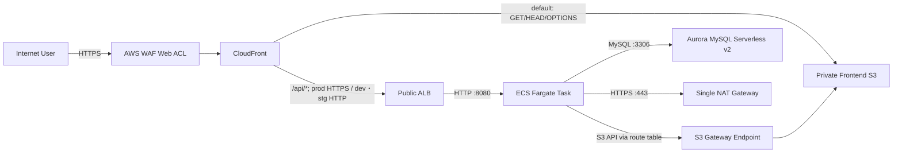
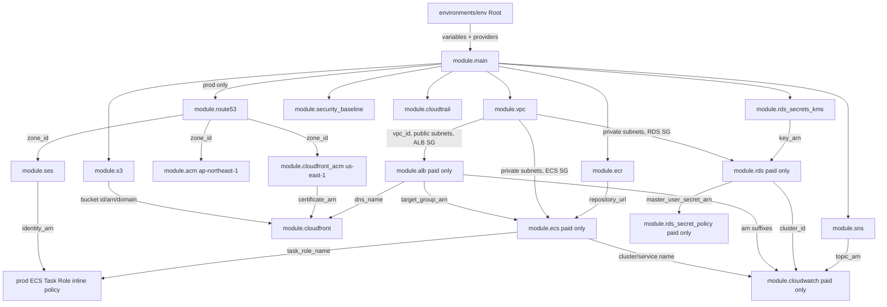
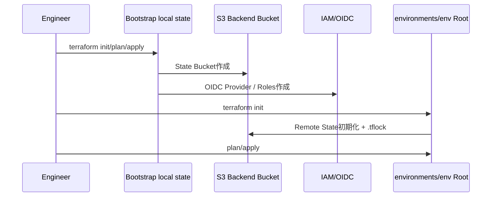
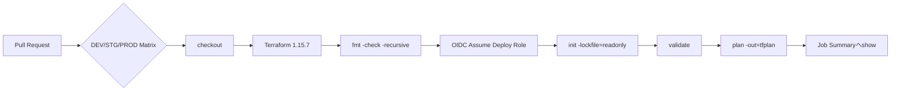

# Terraform Infrastructure Technical Guide

> 対象: `/home/wakk/.my_projects/terraform` の現在の作業ツリー
> 調査日: 2026-11-12
> Source of Truth: 現在の `.tf`、`.tfvars`、`.terraform.lock.hcl`、`.github/workflows/*.yml`
> 注意: この資料はコードの静的解析結果であり、現在AWS上に存在するリソースやTerraform Stateの実内容を照会した結果ではない。

## 1. システム全体像

このリポジトリは、`dev`、`stg`、`prod` の3環境を別々のTerraform Root Moduleとして管理する。各環境Rootは共通オーケストレーターである `module.main`（`source = "../../modules"`）を呼び、環境固有値を `terraform.tfvars` から渡す。

現在の全環境の `enable_paid_resources` は `false` である。この値がStateにも反映済みであると仮定した場合、コード上の実効構成は次のとおり。

- 常設: VPC、Public/Private Subnet、Internet Gateway、Route Table、S3 Gateway Endpoint、Security Group本体、Frontend S3、CloudFront、ECR、RDS Secret用KMS Key、SNS、AWS Config、GuardDuty、Security Hub、Inspector/ECR enhanced scan、CloudTrail。
- `prod` のみ常設: Route 53 Hosted Zone、Regional ACM、CloudFront用us-east-1 ACM、SES、CloudFront/Route 53 Alias Record。
- 現在OFF: NAT Gateway、EIP、Private Subnetのデフォルトルート、ALB、ALB Listener/Target Group、ECS、Aurora、RDS Secret Policy、CloudWatch Metric Alarm、関連Security Group Rule、CloudFrontのALB Originと `/api/*` Behavior。

`enable_paid_resources = true` のとき、コードから復元できる主な通信経路は次のとおり。



重要な境界事項:

- CloudFrontのDefault Originは常にFrontend S3である。
- `/api/*` のALB Originは `enable_paid_resources = true` の場合だけ存在する。
- `prod` はCloudFrontからALBまでHTTPS。`dev`/`stg` はCloudFrontからALBまでHTTP。
- ECSからAuroraへのネットワークルールはあるが、DB endpoint、DB名、Secret ARNをECS Task Definitionへ渡す実装と、Task RoleのSecrets Manager/KMS権限はない。アプリケーションがどのようにDB接続情報を取得する設計かはコードから判断できない。
- Service Auto Scaling用Resourceは実装されていない。

## 2. ディレクトリ構成

`.terraform/` とGit内部ファイルを除いた、管理対象の実構成は次のとおり。

```text
.
├── README.md
├── TERRAFORM_TECHNICAL_GUIDE.md
├── .gitignore
├── .terraform.lock.hcl
├── .github/workflows/
│   ├── terraform.yml
│   ├── deploy-dev.yml       # 0 byte
│   ├── deploy-stg.yml       # 0 byte
│   └── deploy-prod.yml      # 0 byte
├── environments/
│   ├── dev/
│   │   ├── main.tf
│   │   ├── variables.tf
│   │   ├── terraform.tfvars
│   │   ├── providers.tf
│   │   ├── backend.tf
│   │   ├── outputs.tf
│   │   ├── .terraform.lock.hcl
│   │   └── bootstrap/
│   │       ├── main.tf
│   │       ├── terraform.tfvars
│   │       └── .terraform.lock.hcl
│   ├── stg/                 # devと同じRootファイル構成
│   └── prod/                # devと同じRootファイル構成
└── modules/
    ├── main.tf              # 共通オーケストレーター
    ├── variables.tf
    ├── outputs.tf
    ├── providers.tf
    ├── bootstrap/
    ├── acm/
    ├── alb/
    ├── cloudfront/
    ├── cloudtrail/
    ├── cloudwatch/
    ├── ecr/
    ├── ecs/
    ├── kms/
    ├── rds/
    ├── route53/
    ├── s3/
    ├── secrets_manager/
    ├── security_baseline/
    ├── ses/
    ├── sns/
    └── vpc/
```

| パス | 役割 |
|---|---|
| `environments/<env>/main.tf` | 環境Rootから `module.main` を呼び、Root Variableを共通モジュールへ渡す |
| `environments/<env>/terraform.tfvars` | 環境固有のCIDR、スペック、保持日数、機能フラグ |
| `environments/<env>/providers.tf` | Terraform/AWS Provider制約、通常Regionと `aws.us_east_1` Alias、共通Tag |
| `environments/<env>/backend.tf` | 環境別S3 Remote BackendとS3 Native Locking |
| `environments/<env>/outputs.tf` | `module.main` OutputのRootへの再公開 |
| `environments/<env>/bootstrap/main.tf` | State Bucket、GitHub OIDC Provider、Terraform/Application Deploy RoleをローカルStateで先行作成 |
| `modules/main.tf` | 全Child Moduleの呼び出し、Module間Outputの配線、環境/機能条件 |
| `.github/workflows/terraform.yml` | PR時の3環境Planと、手動実行時の1環境Plan/Apply |

## 3. DEV / STG / PROD構成

### 3.1 Root ModuleとProvider

3環境ともRoot Module構造は同じで、`module "main" { source = "../../modules" }` を1回呼ぶ。Providerは次の2構成。

- `aws`: `var.aws_region`。現在は全環境 `ap-northeast-1`。
- `aws.us_east_1`: `us-east-1`。CloudFront用ACMとCloudFront Scope WAF/WAF Logsへ渡す。
- `default_tags`: `Project`、`Environment`、`ManagedBy = "Terraform"`。
- `stg` と `prod` は両Providerに `allowed_account_ids` がある。`dev` にはない。

Terraform要件は全Root/Bootstrapで `required_version = "~> 1.13"`、AWS Providerは `~> 6.0`。環境Lockfileは現在 `hashicorp/aws 6.63.0` を固定している。

### 3.2 環境差分

| 項目 | DEV | STG | PROD |
|---|---:|---:|---:|
| AWS Account ID（コードから確認可能） | `463200133916`（backend名） | `721563685066` | `587552118918` |
| VPC CIDR | `10.2.0.0/16` | `10.1.0.0/16` | `10.0.0.0/16` |
| AZ | `ap-northeast-1a`, `1c` | 同左 | 同左 |
| Domain Variable | `dev.waki-cloud-lab.com` | `stg.waki-cloud-lab.com` | `prod.waki-cloud-lab.com` |
| `enable_paid_resources` | `false` | `false` | `false` |
| ECS CPU / Memory | `256 / 512 MiB` | `512 / 1024 MiB` | `1024 / 2048 MiB` |
| ECS initial desired count | 1 | 1 | 2 |
| Auto Scaling変数（未使用） | min 1 / max 2 / CPU 70 | min 1 / max 3 / CPU 65 | min 2 / max 6 / CPU 60 |
| ECR tagged image保持 | 5 | 10 | 20 |
| ECR untagged期限 | 3日 | 7日 | 14日 |
| Log retention | 7日 | 14日 | 30日 |
| Aurora instance数 | 1 | 1 | 2 |
| Aurora ACU | 1–2 | 1–2 | 2–16 |
| Backup retention | 1日 | 7日 | 14日 |
| RDS deletion protection | false | false | true |
| Skip final snapshot | true | false | false |
| SNS email | `wakk12107@gmail.com` | 同左 | 同左 |
| Route 53 / ACM / SES | 作成しない | 作成しない | 作成する |
| Site URL Output | CloudFront標準Domain | CloudFront標準Domain | `https://prod.waki-cloud-lab.com` |

### 3.3 Subnet計算

`cidrsubnet(var.vpc_cidr, 8, index)` を使用するため、各 `/16` から4つの `/24` を作る。

| 環境 | Public 1 / 2 | Private 1 / 2 |
|---|---|---|
| prod | `10.0.0.0/24`, `10.0.1.0/24` | `10.0.2.0/24`, `10.0.3.0/24` |
| stg | `10.1.0.0/24`, `10.1.1.0/24` | `10.1.2.0/24`, `10.1.3.0/24` |
| dev | `10.2.0.0/24`, `10.2.1.0/24` | `10.2.2.0/24`, `10.2.3.0/24` |

### 3.4 Backend差分

| 環境 | S3 Bucket | Key | Lock |
|---|---|---|---|
| dev | `grant-application-dev-tfstate-463200133916-ap-northeast-1` | `dev/terraform.tfstate` | `use_lockfile = true` |
| stg | `grant-application-stg-terraform-state-721563685066-ap-northeast-1` | `stg/terraform.tfstate` | 同左 |
| prod | `grant-application-prod-terraform-state-587552118918-ap-northeast-1` | `prod/terraform.tfstate` | 同左 |

全Backendで `region = "ap-northeast-1"`、`encrypt = true`。devだけBucket名が `tfstate`、stg/prodは `terraform-state` で命名規則が異なる。

### 3.5 Root Output差分

- 全環境共通: `cloudfront_distribution_id`, `cloudfront_domain_name`, `site_url`, `rds_cluster_id`, `rds_endpoint`, `rds_reader_endpoint`, `rds_port`, `rds_master_user_secret_arn`（sensitive）、`rds_secrets_kms_key_arn`, `cloudwatch_alarm_arns`, `config_recorder_name`, `config_bucket_name`, `cloudtrail_arn`, `cloudtrail_bucket_name`, `guardduty_detector_id`, `securityhub_arn`, `ecr_scan_type`。
- devのみ追加: `ecr_repository_name`。
- prodのみ追加: `route53_zone_id`, `route53_name_servers`, `acm_certificate_arn`, `ses_identity_arn`, `ses_domain_name`, `ses_mail_from_domain`, `ses_configuration_set_name`。
- 共通Moduleには `ecr_repository_url` と `ecr_repository_name` の両Outputがあるが、Environment Rootでの再公開は上記のとおり不統一。

## 4. Module一覧・詳細

### 4.1 Root Moduleと共通オーケストレーター

#### `environments/{dev,stg,prod}`

- 呼び出し先: `module.main` → `../../modules`。
- Inputs: `project_name`, `environment`, `aws_region`, `vpc_cidr`, `availability_zones`, `application_port`, `domain_name`, `frontend_bucket_name`, `frontend_bucket_force_destroy`, `enable_paid_resources`, ECR/ECS/RDS/CloudWatch/Config関連Variable。
- Outputs: CloudFront、RDS、KMS、CloudWatch、Config、CloudTrail、GuardDuty、Security Hub、ECR scan。devのみECR Repository名、prodのみRoute 53/ACM/SESも再公開。
- 修正影響: Root Variableやtfvarsの変更はその環境だけに作用する。ただしAWS Config、Inspector、ECR Registry Scanなどアカウント/リージョン単位のResourceには注意する。

#### `modules` (`module.main`)

- 役割: Child Moduleの呼び出しとOutput配線。
- Provider: Default `aws` とAlias `aws.us_east_1` を要求。
- 直接作成Resource:
  - `aws_route53_record.alb_origin`（prodかつpaid）。
  - `aws_route53_record.cloudfront_ipv4` / `cloudfront_ipv6`（prod）。
  - `data.aws_iam_policy_document.ecs_ses_send` と `aws_iam_role_policy.ecs_ses_send`（prodかつpaid）。
- Child Modules: `vpc`, `s3`, `route53`, `acm`, `cloudfront_acm`, `ses`, `ecr`, `alb`, `cloudfront`, `ecs`, `rds_secrets_kms`, `rds`, `rds_secret_policy`, `sns`, `cloudwatch`, `security_baseline`, `cloudtrail`。
- State migration: `moved { from = module.ecr[0] to = module.ecr }` と `module.security_baseline[0]` の移動宣言がある。
- 修正影響: Module間の契約点であり、条件式やOutput参照を変えると複数サービスへ波及する。

### 4.2 Network Modules

#### `modules/vpc` (`module.vpc`)

| 項目 | 内容 |
|---|---|
| 呼び出し元 | `modules/main.tf`、常時1個 |
| Inputs | `project_name`, `environment`, `vpc_cidr`, `availability_zones`, `application_port`, `common_tags`, `enable_paid_resources` |
| Data | `aws_region.current`; prodのみ `aws_ec2_managed_prefix_list.cloudfront_origin_facing` |
| Resources | `aws_vpc.main`, `aws_subnet.public/private`, `aws_internet_gateway.main`, public/private Route TableとAssociation、`aws_vpc_endpoint.s3`, `aws_security_group.alb/ecs/rds` |
| paid時Resources | `aws_eip.nat[0]`, `aws_nat_gateway.main[0]`, `aws_route.private_internet[0]`、全SG Rule |
| Outputs | `vpc_id`, `public_subnet_ids`, `private_subnet_ids`, `alb_security_group_id`, `ecs_security_group_id`, `rds_security_group_id` |
| 下流 | ALB、ECS、RDS |

条件・影響:

- Subnet数は `length(var.availability_zones)`。現在Public 2、Private 2。
- NATはPublic Subnetの先頭AZに1個だけで、Private Route Tableも1個。AZ冗長性はない。
- S3 Gateway Endpointは常設でPrivate Route Tableへ関連付ける。
- VPC CIDR、Subnet CIDR、AZ変更は置換や広範な依存Resource再作成を起こし得る。

#### `modules/alb` (`module.alb`)

| 項目 | 内容 |
|---|---|
| 呼び出し条件 | `enable_paid_resources ? 1 : 0` |
| Inputs | `project_name`, `environment`, `vpc_id`, `vpc_cidr`, `availability_zones`, `common_tags`, `alb_security_group_id`, `public_subnet_ids`, `certificate_arn`, `ssl_policy`, `application_port`, `health_check_path` |
| Resources | `aws_lb.main`, `aws_lb_target_group.main`, `aws_lb_listener.http`, 証明書がある場合 `aws_lb_listener.https[0]` |
| Dynamic | HTTP ListenerのActionは証明書ありならHTTPS redirect、なしならTarget Groupへforward |
| Outputs | `dns_name`, `zone_id`, `target_group_arn`, `arn_suffix`, `target_group_arn_suffix` |
| 下流 | ECS Service、CloudFront Origin、CloudWatch Alarm、prod Route 53 origin Record |

実効動作:

- Internet-facing ALBを2つのPublic Subnetへ配置。
- prodはACM証明書あり: HTTP→HTTPS redirect、HTTPS→ECS。
- dev/stgは証明書なし: HTTP→ECS。HTTPS Listenerはない。
- prodだけDeletion Protection有効。
- `vpc_cidr` と `availability_zones` はモジュール内部で未使用。

#### `modules/route53` (`module.route53`)

- 呼び出し条件: `environment == "prod" ? 1 : 0`。
- Inputs: `project_name`, `environment`, `domain_name`, `common_tags`。
- Resource: `aws_route53_zone.main`。現在は `prod.waki-cloud-lab.com` のPublic Hosted Zone。
- Outputs: `zone_id`, `name_servers`。
- 下流: ACM DNS Validation、SES DNS Record、CloudFront/ALB Alias Record。
- 親Zone `waki-cloud-lab.com` へのNS Delegationはこのコードでは作らず、Outputを使った外部作業になる。

#### `modules/cloudfront` (`module.cloudfront`)

| 項目 | 内容 |
|---|---|
| 呼び出し元 | `modules/main.tf`、常設 |
| Inputs | `project_name`, `environment`, Frontend Bucket ID/ARN/Regional Domain、`enable_paid_resources`, `enable_alb_origin`, `alb_origin_domain_name`, `alb_origin_protocol_policy`, `aliases`, `acm_certificate_arn`, `backend_path_pattern`, `price_class`, `waf_log_retention_days`, `common_tags` |
| Data | AWS Managed Cache Policy 2種、Origin Request Policy、Security Headers Policy |
| Resources | OAC、CloudFront Distribution、Frontend S3 Bucket Policy、WAF Web ACL、WAF Log Group、WAF Logging Configuration |
| Outputs | `distribution_id`, `distribution_arn`, `domain_name`, `hosted_zone_id` |

条件・経路:

- Frontend S3 OriginとDefault Behaviorは常時存在。OAC SigV4で `s3:GetObject` のみ許可。
- `enable_alb_origin` のときだけDynamic `origin` と `/api/*` の `ordered_cache_behavior` を作る。
- FrontendはManaged CachingOptimized、APIはManaged CachingDisabled。
- prodのみAliasとus-east-1 ACMを設定。dev/stgはCloudFront Default Certificate。
- WAFは `enable_paid_resources = true` の場合のみ作成する。4つのAWS Managed Rule GroupとIP単位Rate Rule（limit 2000）を持つ。Web ACL・ログ関連リソースも同じFlagで制御する。
- WAF Logはus-east-1 CloudWatch Logsへ出力し、Authorization/Cookie HeaderをRedactする。
- Distribution変更は全ユーザー経路へ影響し、反映に時間を要する。

### 4.3 Storage / Container Modules

#### `modules/s3` (`module.s3`)

- 呼び出し元: `modules/main.tf`、常設。
- Inputs: 実際に渡されるのは `project_name`, `environment`, `common_tags`。
- Local: `buckets = { frontend = { purpose = "Frontend SPA assets", force_destroy = false } }`。
- Resources（`for_each = local.buckets`）: Bucket、Public Access Block、BucketOwnerEnforced Ownership、Versioning、SSE-S3 (`AES256`)。
- Output: `buckets` Map（各Bucketの `id`, `arn`, `bucket_regional_domain_name`）。
- 下流: `module.cloudfront`。
- `bucket_name` と `force_destroy` Variableは定義されるがResourceで未使用。上位の `frontend_bucket_name` / `frontend_bucket_force_destroy` も配線されていない。

#### `modules/ecr` (`module.ecr`)

- 呼び出し元: `modules/main.tf`、常設。
- Inputs: `project_name`, `environment`, `common_tags`, `keep_image_count`, `untagged_image_expiration_days`。
- Resources: `aws_ecr_repository.main`, `aws_ecr_lifecycle_policy.main`。
- 名前: prod=`grant-application-app`、dev/stg=`grant-application-<env>-app`。
- 設定: Immutable Tag、AES256、Untagged期限削除、Tagged Image世代数保持。
- Outputs: `repository_url`, `repository_name`。
- 下流: ECS Task Definition、Bootstrap Application RoleのPolicy命名。
- Enhanced ScanはECR Moduleではなく `security_baseline` のアカウント/リージョン設定。

#### `modules/ecs` (`module.ecs`)

| 項目 | 内容 |
|---|---|
| 呼び出し条件 | `enable_paid_resources ? 1 : 0` |
| Inputs | VPC Private Subnet、ECS SG、Target Group ARN、ECR URL、Image Tag、Container名/Port、CPU/Memory、desired count、Auto Scaling 3変数、Log保持、環境変数 |
| Resources | ECS Cluster、Task Execution Role + AWS Managed Policy、Task Role、Log Group、Task Definition、ECS Service |
| Outputs | `task_role_name`, `task_role_arn`, `cluster_name`, `service_name` |
| 下流 | prod SES inline policy、CloudWatch Alarm、Application Deploy Roleの対象名 |

実装上の要点:

- Fargate、`awsvpc`、Linux/X86_64、Private Subnet、Public IPなし。
- Task Definitionは `ECR URL:bootstrap_image_tag` を初回Imageとして使用。
- 環境変数は `APP_ENV` と `container_environment`。機密値用 `secrets` Blockはない。
- ECS ServiceはDeployment Circuit Breaker/rollbackを有効化。
- `lifecycle.ignore_changes = [desired_count, task_definition]`。初回以後のTask Definition Revisionとdesired countはTerraform差分として無視する。
- `autoscaling_min_capacity`, `autoscaling_max_capacity`, `autoscaling_cpu_target` は受け取るが、Auto Scaling Resourceがないため未使用。
- Task Roleは通常権限なし。prodかつpaid時だけSES Send inline policyが上位から付く。

### 4.4 Database / Secret Modules

#### `modules/rds` (`module.rds`)

| 項目 | 内容 |
|---|---|
| 呼び出し条件 | `enable_paid_resources ? 1 : 0` |
| Inputs | Private Subnet IDs、RDS SG、DB名/User、KMS Key ARN、Engine Version、Instance数、ACU min/max、Backup/Maintenance、削除保護、Final Snapshot、Performance Insights、IAM DB Auth |
| Resources | DB Subnet Group、Cluster/Instance Parameter Group、`aws_rds_cluster.main`、`aws_rds_cluster_instance.main[count]` |
| Outputs | `cluster_id`, `cluster_arn`, `endpoint`, `reader_endpoint`, `port`, `master_user_secret_arn`, ACU min/max |
| 下流 | Secrets Manager Secret Policy、CloudWatch Alarm、Root Outputs |

設定:

- Aurora MySQL、`engine_mode = "provisioned"` + `db.serverless` InstanceによるServerless v2。
- Storage暗号化あり。Master PasswordはRDS Managed Secretで、専用KMS Keyを使用。
- Private Subnet、Public accessなし、SGはECSから3306のみ。
- Error/Slow Query LogをCloudWatchへExport。
- Cluster Parameter: `utf8mb4`, `utf8mb4_0900_ai_ci`, `Asia/Tokyo`。
- Performance Insights保持は有効時7日。
- Final Snapshot名は固定の `<project>-<env>-aurora-final`。

#### `modules/kms` (`module.rds_secrets_kms`)

- 常設。Aurora OFFでもRDS Secret復号不能を避ける意図で維持。
- Inputs: `project_name`, `environment`, `alias_suffix = "rds-secrets"`, `description`, `deletion_window_in_days`, `common_tags`。
- Resources: `aws_kms_key.main`, `aws_kms_alias.main`。
- 設定: Rotation有効、削除待機30日（上位Default）。明示的Key PolicyはなくAWS Default Policy。
- Outputs: `key_id`, `key_arn`, `alias_name`。RDSへ `key_arn` を渡す。

#### `modules/secrets_manager` (`module.rds_secret_policy`)

- 呼び出し条件: `enable_paid_resources ? 1 : 0`。
- Input: RDS Output `master_user_secret_arn`。
- Resource: `aws_secretsmanager_secret_policy.rds_master_user`。
- 内容: 非TLSアクセスをDenyし、`block_public_policy = true`。
- Secret自体はこのModuleでは作らず、`aws_rds_cluster.main` が管理する。
- Output: `secret_arn`（上位では利用されていない）。

### 4.5 DNS / Certificate / Mail Modules

#### `modules/acm` (`module.acm`, `module.cloudfront_acm`)

- 呼び出し条件: prodのみ。同じModuleを2回呼ぶ。
- `module.acm`: ap-northeast-1、ALB用、Apex + `*.prod.waki-cloud-lab.com`。
- `module.cloudfront_acm`: us-east-1 Alias Provider、CloudFront用、Apexのみ。
- Inputs: `project_name`, `environment`, `domain_name`, `subject_alternative_names`, `route53_zone_id`, `common_tags`。
- Resources: ACM Certificate、Route 53 DNS Validation Record (`for_each`)、Certificate Validation。
- Lifecycle: Certificateは `create_before_destroy = true`。
- Output: `certificate_arn`。

#### `modules/ses` (`module.ses`)

- 呼び出し条件: prodのみ。
- Inputs: `project_name`, `environment`, `aws_region`, `domain_name`, `route53_zone_id`, `dmarc_record`, `common_tags`。
- Resources: SESv2 Configuration Set、Domain Identity、DKIM CNAME 3件、Custom MAIL FROM、MX/SPF/DMARC Record。
- Configuration Set: TLS必須、Reputation Metrics、Sending有効、Bounce/Complaint Suppression。
- Default DMARCは `p=none` で監視モード。
- Outputs: `identity_arn`, `domain_name`, `mail_from_domain`, `configuration_set_name`。
- prodかつpaid時、上位がECS Task RoleへこのIdentity限定のSendEmail/SendRawEmail権限を付ける。

### 4.6 Monitoring / Security Modules

#### `modules/sns` (`module.sns`)

- 条件: `length(cloudwatch_alarm_email_addresses) > 0 ? 1 : 0`。現在は全環境作成。
- Inputs: `project_name`, `environment`, `common_tags`, `email_addresses`。
- Resources: SNS Topic、CloudWatchだけにPublishを許可するTopic Policy、Email Subscription (`for_each`)。
- Output: `topic_arn`。CloudWatch Alarm Actionへ追加。
- Email Subscriptionは受信者によるConfirmが必要。TopicのKMS暗号化設定はない。

#### `modules/cloudwatch` (`module.cloudwatch`)

- 条件: `enable_paid_resources ? 1 : 0`。
- Inputs: ECS Cluster/Service名、ALB/Target Group ARN suffix、RDS Cluster ID、追加Alarm Action、Tag。
- Resource: `aws_cloudwatch_metric_alarm.main` (`for_each = local.alarms`)。
- Alarm: ECS CPU/Memory、ALB Unhealthy Host、ALB 5xx、Target 5xx、RDS CPU。
- 5分Period、Alarm/OK両方をSNSへ通知。
- Output: `alarm_arns` Map。
- ECS/WAF Logsは各サービスModule側で作成する。

#### `modules/security_baseline` (`module.security_baseline`)

- 常設。Inputsは `project_name`, `environment`, `common_tags`, `include_global_resource_types`。
- Data: Caller Identity、Region、Partition。
- AWS Config Resources: 専用S3 Bucket、Public Block、Ownership、Versioning、AES256、Bucket Policy、Config IAM Role/Policy、Recorder、Delivery Channel、Recorder Status。
- Threat Detection: `aws_guardduty_detector.main`。
- Inspector/ECR: `aws_inspector2_enabler.main`、`aws_ecr_registry_scanning_configuration.main`（全RepositoryをEnhanced Scan on push）。
- Security Hub: Account有効化、Default Standards、GuardDuty/Inspector Product Subscription。
- Outputs: Config Recorder/Bucket、GuardDuty Detector、Security Hub ARN、ECR Scan Type。
- 注意: Config Recorder、Inspector Enabler、ECR Registry Scanning、Security Hubはアカウント/リージョン単位の性質が強く、既存管理との競合を確認する。

#### `modules/cloudtrail` (`module.cloudtrail`)

- 常設。Inputs: `project_name`, `environment`, `common_tags`。
- Resources: Log S3 Bucket一式と `aws_cloudtrail.main`。
- Trail: Multi-Region、Global Service Eventあり、Log File Validationあり、Organization Trailではない。
- Event: Read/Write Management Eventのみ。S3/Lambda等のData Eventはない。
- Bucket: Public Block、BucketOwnerEnforced、Versioning、AES256、TLS強制、`force_destroy = false`。
- Outputs: `trail_arn`, `bucket_name`。

### 4.7 Bootstrap Module

#### `modules/bootstrap`

- 呼び出し元: `environments/<env>/bootstrap/main.tf` の `module.github_actions_oidc`。
- Inputs: Project/Environment/Region/Account ID、Terraform/Application GitHub Repository名。
- Resources: GitHub OIDC Provider、Terraform Deploy Role、`PowerUserAccess` Attachment、Project IAM Inline Policy、Application Deploy RoleとInline Policy。
- Outputs: `terraform_deploy_role_arn`, `application_deploy_role_arn`, `github_oidc_provider_arn`。Bootstrap Rootはこれらに加えてState Bucketの `bucket_name` を公開する。
- 詳細は「8. Terraform State / Bootstrap」「9. GitHub Actions / CI/CD」を参照。

### 4.8 Resource / Data / Local Address索引

主要説明で省略形を使ったResourceも含め、宣言されているTerraform AddressをModule単位で列挙する。`count`/`for_each` 使用時は実State Addressにindex/keyが付く。

| Module | Resource Address |
|---|---|
| `environments/<env>/bootstrap` | `aws_s3_bucket.terraform_state`, `aws_s3_bucket_versioning.terraform_state`, `aws_s3_bucket_server_side_encryption_configuration.terraform_state`, `aws_s3_bucket_public_access_block.terraform_state`, `aws_s3_bucket_ownership_controls.terraform_state`, `aws_s3_bucket_policy.require_tls` |
| `modules` | `aws_route53_record.alb_origin`, `aws_route53_record.cloudfront_ipv4`, `aws_route53_record.cloudfront_ipv6`, `aws_iam_role_policy.ecs_ses_send` |
| `vpc` | `aws_vpc.main`, `aws_subnet.public`, `aws_subnet.private`, `aws_internet_gateway.main`, `aws_eip.nat`, `aws_nat_gateway.main`, `aws_route_table.public`, `aws_route.public_internet`, `aws_route_table_association.public`, `aws_route_table.private`, `aws_route.private_internet`, `aws_route_table_association.private`, `aws_vpc_endpoint.s3`, `aws_security_group.alb`, `aws_security_group.ecs`, `aws_security_group.rds`, `aws_vpc_security_group_ingress_rule.alb_https`, `aws_vpc_security_group_ingress_rule.alb_http`, `aws_vpc_security_group_ingress_rule.ecs_from_alb`, `aws_vpc_security_group_ingress_rule.rds_from_ecs`, `aws_vpc_security_group_egress_rule.alb_to_ecs`, `aws_vpc_security_group_egress_rule.ecs_https`, `aws_vpc_security_group_egress_rule.ecs_to_rds` |
| `alb` | `aws_lb.main`, `aws_lb_target_group.main`, `aws_lb_listener.http`, `aws_lb_listener.https` |
| `cloudfront` | `aws_cloudfront_origin_access_control.frontend`, `aws_cloudfront_distribution.main`, `aws_s3_bucket_policy.frontend`, `aws_wafv2_web_acl.main`, `aws_cloudwatch_log_group.waf`, `aws_wafv2_web_acl_logging_configuration.main` |
| `route53` | `aws_route53_zone.main` |
| `s3` | `aws_s3_bucket.this`, `aws_s3_bucket_public_access_block.this`, `aws_s3_bucket_ownership_controls.this`, `aws_s3_bucket_versioning.this`, `aws_s3_bucket_server_side_encryption_configuration.this` |
| `ecr` | `aws_ecr_repository.main`, `aws_ecr_lifecycle_policy.main` |
| `ecs` | `aws_ecs_cluster.main`, `aws_iam_role.task_execution`, `aws_iam_role_policy_attachment.task_execution`, `aws_iam_role.task`, `aws_cloudwatch_log_group.ecs`, `aws_ecs_task_definition.main`, `aws_ecs_service.main` |
| `rds` | `aws_db_subnet_group.main`, `aws_rds_cluster_parameter_group.main`, `aws_db_parameter_group.main`, `aws_rds_cluster.main`, `aws_rds_cluster_instance.main` |
| `acm` | `aws_acm_certificate.main`, `aws_route53_record.validation`, `aws_acm_certificate_validation.main` |
| `kms` | `aws_kms_key.main`, `aws_kms_alias.main` |
| `secrets_manager` | `aws_secretsmanager_secret_policy.rds_master_user` |
| `sns` | `aws_sns_topic.alarms`, `aws_sns_topic_policy.alarms`, `aws_sns_topic_subscription.email` |
| `cloudwatch` | `aws_cloudwatch_metric_alarm.main` |
| `security_baseline` | `aws_s3_bucket.config`, `aws_s3_bucket_public_access_block.config`, `aws_s3_bucket_ownership_controls.config`, `aws_s3_bucket_versioning.config`, `aws_s3_bucket_server_side_encryption_configuration.config`, `aws_s3_bucket_policy.config`, `aws_iam_role.config`, `aws_iam_role_policy_attachment.config`, `aws_iam_role_policy.config_delivery`, `aws_config_configuration_recorder.main`, `aws_config_delivery_channel.main`, `aws_config_configuration_recorder_status.main`, `aws_guardduty_detector.main`, `aws_inspector2_enabler.main`, `aws_ecr_registry_scanning_configuration.main`, `aws_securityhub_account.main`, `aws_securityhub_product_subscription.guardduty`, `aws_securityhub_product_subscription.inspector` |
| `cloudtrail` | `aws_s3_bucket.logs`, `aws_s3_bucket_public_access_block.logs`, `aws_s3_bucket_ownership_controls.logs`, `aws_s3_bucket_versioning.logs`, `aws_s3_bucket_server_side_encryption_configuration.logs`, `aws_s3_bucket_policy.logs`, `aws_cloudtrail.main` |
| `ses` | `aws_sesv2_configuration_set.main`, `aws_sesv2_email_identity.main`, `aws_route53_record.dkim`, `aws_sesv2_email_identity_mail_from_attributes.main`, `aws_route53_record.mail_from_mx`, `aws_route53_record.mail_from_spf`, `aws_route53_record.dmarc` |
| `bootstrap` | `aws_iam_openid_connect_provider.github`, `aws_iam_role.terraform_deploy`, `aws_iam_role_policy_attachment.terraform_power_user_access`, `aws_iam_role_policy.terraform_project_iam`, `aws_iam_role.application_deploy`, `aws_iam_role_policy.application_deploy` |

主要Data/Local:

- Caller/Region/Partition: `data.aws_caller_identity.current`, `data.aws_region.current`, `data.aws_partition.current` をS3/SNS/Config/CloudTrail等で使用。
- Policy生成: `data.aws_iam_policy_document.*` をCloudFront S3 Policy、SNS、Config、CloudTrail、Secrets Manager、Bootstrap、prod SES Task Policyで使用。
- CloudFront: Managed Cache/Origin Request/Response Headers PolicyをData Sourceで取得し、`local.frontend_origin_id`, `local.backend_origin_id` を使用。
- VPC: prodのみ `data.aws_ec2_managed_prefix_list.cloudfront_origin_facing`。
- Identity Center: `data.aws_ssoadmin_instances.this`, `data.aws_identitystore_group.this` と `local.instance_arn`, `local.identity_store_id`。
- Bootstrap: Role/Repository/Cluster/Service/Task名をLocalで組み立てる。

### 4.9 Variable Contract索引

同名Variableは層ごとに別の契約である。環境値を追加する場合は、Environment RootからLeaf Moduleまで必要な全層を配線する。

| Module / Root | Variable名 |
|---|---|
| `environments/<env>` | `project_name`, `environment`, `aws_region`, `vpc_cidr`, `availability_zones`, `application_port`, `domain_name`, `frontend_bucket_name`, `frontend_bucket_force_destroy`, `enable_paid_resources`, `keep_image_count`, `untagged_image_expiration_days`, `ssl_policy`, `health_check_path`, `bootstrap_image_tag`, `container_name`, `task_cpu`, `task_memory`, `desired_count`, `autoscaling_min_capacity`, `autoscaling_max_capacity`, `autoscaling_cpu_target`, `log_retention_days`, `container_environment`, `database_name`, `database_master_username`, `aurora_engine_version`, `rds_instance_count`, `aurora_serverless_min_capacity`, `aurora_serverless_max_capacity`, `rds_backup_retention_period`, `rds_deletion_protection`, `rds_skip_final_snapshot`, `cloudwatch_alarm_actions`, `config_include_global_resource_types`, `cloudwatch_alarm_email_addresses` |
| `modules` | 上記に加え、`common_tags`, `cloudfront_backend_path_pattern`, `cloudfront_price_class`, `kms_deletion_window_in_days`, `rds_preferred_backup_window`, `rds_preferred_maintenance_window`, `rds_apply_immediately`, `rds_performance_insights_enabled`, `rds_iam_database_authentication_enabled` |
| `vpc` | `project_name`, `environment`, `vpc_cidr`, `availability_zones`, `common_tags`, `application_port`, `enable_paid_resources` |
| `alb` | `project_name`, `environment`, `vpc_id`, `vpc_cidr`, `availability_zones`, `common_tags`, `alb_security_group_id`, `public_subnet_ids`, `certificate_arn`, `ssl_policy`, `application_port`, `health_check_path` |
| `cloudfront` | `project_name`, `environment`, `frontend_bucket_id`, `frontend_bucket_arn`, `frontend_bucket_regional_domain_name`, `alb_origin_domain_name`, `enable_paid_resources`, `enable_alb_origin`, `alb_origin_protocol_policy`, `aliases`, `acm_certificate_arn`, `backend_path_pattern`, `price_class`, `waf_log_retention_days`, `common_tags` |
| `route53` | `project_name`, `environment`, `domain_name`, `common_tags` |
| `s3` | `project_name`, `environment`, `bucket_name`, `force_destroy`, `common_tags` |
| `ecr` | `project_name`, `environment`, `common_tags`, `keep_image_count`, `untagged_image_expiration_days` |
| `ecs` | `project_name`, `environment`, `aws_region`, `common_tags`, `private_subnet_ids`, `ecs_security_group_id`, `target_group_arn`, `ecr_repository_url`, `bootstrap_image_tag`, `container_name`, `application_port`, `task_cpu`, `task_memory`, `desired_count`, `autoscaling_min_capacity`, `autoscaling_max_capacity`, `autoscaling_cpu_target`, `log_retention_days`, `container_environment` |
| `rds` | `project_name`, `environment`, `private_subnet_ids`, `rds_security_group_id`, `common_tags`, `database_name`, `master_username`, `master_user_secret_kms_key_id`, `engine_version`, `instance_count`, `serverless_min_capacity`, `serverless_max_capacity`, `backup_retention_period`, `preferred_backup_window`, `preferred_maintenance_window`, `deletion_protection`, `skip_final_snapshot`, `apply_immediately`, `performance_insights_enabled`, `iam_database_authentication_enabled` |
| `acm` | `project_name`, `environment`, `domain_name`, `subject_alternative_names`, `route53_zone_id`, `common_tags` |
| `kms` | `project_name`, `environment`, `alias_suffix`, `description`, `deletion_window_in_days`, `common_tags` |
| `secrets_manager` | `secret_arn` |
| `sns` | `project_name`, `environment`, `common_tags`, `email_addresses` |
| `cloudwatch` | `project_name`, `environment`, `ecs_cluster_name`, `ecs_service_name`, `alb_arn_suffix`, `target_group_arn_suffix`, `rds_cluster_id`, `common_tags`, `alarm_actions` |
| `security_baseline` | `project_name`, `environment`, `common_tags`, `include_global_resource_types` |
| `cloudtrail` | `project_name`, `environment`, `common_tags` |
| `ses` | `project_name`, `environment`, `aws_region`, `domain_name`, `route53_zone_id`, `dmarc_record`, `common_tags` |
| `bootstrap` | `project_name`, `environment`, `aws_region`, `aws_account_id`, `terraform_github_repository`, `application_github_repository` |

## 5. Module間の依存関係

### 5.1 Module Graph



### 5.2 主なInput / Output受け渡し

| Producer | Output | Consumer | Input / 用途 |
|---|---|---|---|
| `module.vpc` | `vpc_id` | `module.alb` | Target GroupのVPC |
| `module.vpc` | `public_subnet_ids` | `module.alb` | ALB配置 |
| `module.vpc` | `private_subnet_ids` | `module.ecs`, `module.rds` | ECS ENI / DB Subnet Group |
| `module.vpc` | 各SG ID | ALB/ECS/RDS | ENI/ClusterへのSG Attachment |
| `module.s3` | `buckets["frontend"].*` | `module.cloudfront` | S3 Origin/OAC Policy |
| `module.route53` | `zone_id` | ACM/SES/Root Record | DNS ValidationとAlias |
| `module.acm` | `certificate_arn` | `module.alb` | prod HTTPS Listener |
| `module.cloudfront_acm` | `certificate_arn` | `module.cloudfront` | prod Viewer Certificate |
| `module.alb` | `target_group_arn` | `module.ecs` | ECS Service Load Balancer |
| `module.alb` | `dns_name` | CloudFront/Route 53 | Backend Origin |
| `module.ecr` | `repository_url` | `module.ecs` | 初回Task Definition Image |
| `module.rds_secrets_kms` | `key_arn` | `module.rds` | RDS Managed Secret暗号化 |
| `module.rds` | `master_user_secret_arn` | `module.rds_secret_policy` | Secret Resource Policy |
| ECS/ALB/RDS | 名前/ARN suffix/ID | `module.cloudwatch` | Metric Dimension |
| `module.sns` | `topic_arn` | `module.cloudwatch` | Alarm/OK Action |
| `module.ses` + `module.ecs` | Identity ARN + Task Role名 | Root IAM Policy | prodアプリの送信権限 |

## 6. AWSアーキテクチャ・ネットワーク

### 6.1 ViewerからFrontend/APIまで

| 区間 | prod | dev / stg |
|---|---|---|
| Viewer → CloudFront | HTTPS Redirect、WAF適用 | 同左 |
| CloudFront → S3 | OAC SigV4、private Bucket | 同左 |
| CloudFront → ALB | `https-only`、`origin.prod.waki-cloud-lab.com` | `http-only`、ALB DNS名 |
| ALB Listener | 80→443、443→Target | 80→Target、443なし |
| ALB → ECS | HTTP、Application Port 8080 | 同左 |
| ECS → Aurora | MySQL 3306 | 同左 |

CloudFrontはFrontend Default Behaviorで `GET/HEAD/OPTIONS` のみ許可し、`/api/*` は全一般HTTP Methodを許可する。API Cacheは無効。`enable_paid_resources = false` のとき `/api/*` Behavior自体が消えるため、同パスはFrontend S3 Originへ流れる。

### 6.2 Routing

- Public Route Table: `0.0.0.0/0 → aws_internet_gateway.main`。全Public Subnetに関連付け。
- Private Route Table: 全Private Subnetで共有。
- paid時: `0.0.0.0/0 → aws_nat_gateway.main[0]`。
- 常時: S3 Gateway EndpointをPrivate Route Tableに関連付け。
- NAT Gatewayは `aws_subnet.public[0]` の1台のみ。Public Subnet 2/AZでもNATはMulti-AZではない。

### 6.3 Multi-AZの実態

| 対象 | 実装 |
|---|---|
| ALB | 2つのPublic Subnetを指定。Multi-AZ |
| ECS | 2つのPrivate Subnetを指定。ただしdev/stg desired=1、prod desired=2で、AZ分散を明示するPlacement Strategyはない |
| Aurora Storage | Auroraサービス側の分散。DB Subnet Groupは2AZ |
| Aurora Instance | dev/stg 1台、prod 2台。各InstanceのAZはコードで明示していない |
| NAT | 1AZの1台。AZ障害時の冗長性なし |
| CloudFront/WAF | Global Service |

## 7. IAM・Security Group

### 7.1 Security Group Matrix

SG本体は常設だが、次のRuleはすべて `enable_paid_resources = true` のときだけ作成される。

| SG / Rule | Source | Destination | Protocol/Port | 条件 |
|---|---|---|---|---|
| `alb_https` | prod: CloudFront origin-facing Managed Prefix List、dev/stg: `0.0.0.0/0` | ALB SG | TCP 443 | 全環境paid |
| `alb_http` | `0.0.0.0/0` | ALB SG | TCP 80 | dev/stg paidのみ |
| `alb_to_ecs` | ALB SG | ECS SG | TCP `application_port` (8080) | paid |
| `ecs_from_alb` | ALB SG | ECS SG | TCP 8080 | paid |
| `ecs_https` | ECS SG | `0.0.0.0/0` | TCP 443 | paid |
| `ecs_to_rds` | ECS SG | RDS SG | TCP 3306 | paid |
| `rds_from_ecs` | ECS SG | RDS SG | TCP 3306 | paid |

評価:

- prod ALBの443はCloudFront Managed Prefix Listに限定され、直接アクセスを抑制する。
- dev/stg ALBはHTTP 80を全Internetに公開するため、ALB DNS名を知ればCloudFront/WAFを迂回できる。HTTPS 443もSG上は公開されるがListenerは存在しない。
- ECSの一般外向き通信はHTTPSだけ。RDSはECS SGからの3306だけ。
- Administrative ingress（SSH/RDP等）はない。
- Security GroupのRuleをinlineではなく個別 `aws_vpc_security_group_*_rule` として管理している。

### 7.2 Runtime IAM

| Role/Policy | Principal | 権限 |
|---|---|---|
| `aws_iam_role.task_execution` | `ecs-tasks.amazonaws.com` | AWS Managed `AmazonECSTaskExecutionRolePolicy`。ECR pull、CloudWatch Logs出力等 |
| `aws_iam_role.task` | `ecs-tasks.amazonaws.com` | 通常は権限なし。prodかつpaid時だけ下記SES Policy |
| `aws_iam_role_policy.ecs_ses_send` | ECS Task Role | prod SES Identityに対する `ses:SendEmail`, `ses:SendRawEmail`。From Addressも `*@prod.waki-cloud-lab.com` に限定 |
| `aws_iam_role.config` | `config.amazonaws.com` | AWS Managed Config Role + 専用BucketへのDelivery権限 |

ECS Task Roleには `secretsmanager:GetSecretValue`、`kms:Decrypt`、RDS IAM接続に必要な `rds-db:connect` がない。Task DefinitionにもRDS情報が渡されていない。この状態でアプリがAuroraへどう接続するかはコードから判断できない。

### 7.3 GitHub OIDC IAM

#### Terraform Deploy Role

- 名前: `terraform-gha-<env>-deploy-role`。
- Trust Subject:
  - `repo:wakiyoshi/terraform-aws-infrastructure:ref:refs/heads/main`
  - `repo:wakiyoshi/terraform-aws-infrastructure:environment:<DEV|STG|PROD>`
- Permission:
  - AWS Managed `PowerUserAccess`。
  - `<project>-<env>-*` Roleに限定したIAM Role管理/PassRole inline policy。
  - AWS Managed Policyの `iam:GetPolicy`。
- `PowerUserAccess` は多くの非IAMサービスを広範に操作できる。Terraform対象Resource単位の最小権限ではない。

#### Application Deploy Role

- 名前: `application-gha-<env>-deploy-role`。
- Trust Subject: `repo:wakiyoshi/grant-application-app:environment:<dev|stg|prod>` のみ。
- Permission:
  - 対象ECR Repositoryのpush/pull。
  - `ecr:GetAuthorizationToken` はResource `*`。
  - Task Definition describe/list/register/tagはResource `*`。
  - 対象ECS Serviceのdescribe/update。
  - 対象Task Familyのrun task（対象Cluster条件あり）。
  - 対象Taskのdescribe。
  - 対象ECS Task/Execution RoleのPassRole（ECS Tasks Service条件あり）。
- Frontend S3 uploadやCloudFront Invalidation権限はない。

## 8. Terraform State / Bootstrap

### 8.1 Bootstrapの目的と順序

Remote Backend自身を通常Rootから作れないため、各 `environments/<env>/bootstrap` は独立したローカルStateで次を先行作成する。

1. Terraform State用S3 Bucket。
2. Bucket Versioning、SSE-S3、Public Access Block、BucketOwnerEnforced。
3. TLS以外のS3アクセスを拒否するBucket Policy。
4. GitHub Actions OIDC Provider。
5. Terraform Deploy RoleとApplication Deploy Role。



### 8.2 Bootstrap Rootの差分

| 項目 | dev | stg | prod |
|---|---|---|---|
| Provider `allowed_account_ids` | なし | `721563685066` | `587552118918` |
| Bucket名 | tfvarsの `bucket_name` で明示 | Caller Account IDから生成 | Caller Account IDから生成 |
| Bucket `prevent_destroy` | true | true | true |
| State | Local | Local | Local |

Bootstrap Stateは`.gitignore`の `*.tfstate*` 対象でGit管理されない。紛失時はState Bucket/OIDC/IAMをImportし直す必要がある。安全な保管先や復旧手順はコードから判断できない。

### 8.3 通常Stateの安全機能

- 環境ごとにS3 BucketとKeyを分離。
- S3 Native Locking (`use_lockfile = true`)。DynamoDB Lock Tableは使わない。
- Backendは `encrypt = true`。
- Bootstrap BucketはVersioning、SSE-S3、Public Block、TLS強制、`prevent_destroy`。
- StateにはRDS Secret ARN等の機密性のあるメタデータが入り得る。SSE-S3でありCustomer Managed KMS Keyではない。
- Backend Bucket名/Account ID/Regionは `backend.tf` にhard codeされている。変更時は `terraform init -reconfigure` またはState Migration判断が必要。

### 8.4 安全なBootstrap操作

```bash
export TF_ENV=dev
export AWS_PROFILE=dev-account

aws sso login --profile "$AWS_PROFILE"
aws sts get-caller-identity
terraform -chdir="environments/$TF_ENV/bootstrap" init
terraform -chdir="environments/$TF_ENV/bootstrap" plan
terraform -chdir="environments/$TF_ENV/bootstrap" apply
terraform -chdir="environments/$TF_ENV/bootstrap" output
```

実行前にCaller Account IDと対象環境を照合する。特にdevはProviderの `allowed_account_ids` がないため、誤AccountをProvider側では防げない。

## 9. GitHub Actions / CI/CD

実体のあるWorkflowは `.github/workflows/terraform.yml` のみ。`deploy-dev.yml`、`deploy-stg.yml`、`deploy-prod.yml` は0 byte。

### 9.1 Triggerと共通設定

- `pull_request`: `*.tf`, `*.tfvars`, Lockfile、Workflow変更時。
- `workflow_dispatch`: `DEV`, `STG`, `PROD` を選択してApply。
- Permission: `contents: read`, `id-token: write`。
- 手動Applyは全環境共通の `terraform-apply` Concurrency Groupで直列化。
- Terraform Versionは `1.15.7`、AWS Regionは `ap-northeast-1`。
- Repository Variables: `AWS_ROLE_ARN_<ENV>`, `AWS_ACCOUNT_ID_<ENV>`。

### 9.2 Pull Request Flow



重大な現状不整合: PR JobはGitHub Environmentを指定せずDeploy RoleをAssumeする。PRのOIDC Subjectは通常 `repo:<repo>:pull_request` だが、Bootstrap Trust Policyはmain branchとEnvironment Subjectしか許可しない。そのため、現在のコード同士ではPR PlanのOIDC認証は成立しない。

### 9.3 Manual Apply Flow

1. `workflow_dispatch` で環境を選択。
2. `apply_plan` JobがRole ARN/Account ID形式を検査。
3. OIDC認証、init、planを実施。
4. PlanをJob Summaryへ表示し、`tfplan` Artifactを1日保持。
5. `apply` Jobが `environment: <DEV|STG|PROD>` を使用。GitHub Environment Review Ruleが設定されていればここで承認。
6. 新Runnerで再度init、ArtifactをDownload。
7. `terraform apply -auto-approve tfplan`。

注意点:

- `apply_plan` JobにはGitHub Environment指定がない。main branch以外から手動実行するとTrust Policyに合わない可能性がある。
- 手動Flowには明示的な `fmt` と `validate` Stepがない。`plan` は構成検査を行うが、PRを通さず手動実行できる。
- Workflowは保存済みPlanをApplyするため、PlanとApply間の内容差し替えは抑制される。
- Applyは自動承認だが、GitHub Environment側のRequired Reviewer設定はRepository外部状態であり、このリポジトリから実在を確認できない。

## 10. Terraformコードの読み方

このリポジトリでは、次の順序で読むと値と影響範囲を追いやすい。

1. `environments/<env>/terraform.tfvars`: 実際の環境値を確認する。
2. `environments/<env>/variables.tf`: Rootで受けられる値とDefaultを確認する。
3. `environments/<env>/main.tf`: `module.main` に本当に渡しているか確認する。
4. `modules/variables.tf`: 共通オーケストレーターの契約を確認する。
5. `modules/main.tf`: 対象Child Module、`count`、Module間Outputを確認する。
6. `modules/<module>/variables.tf`: Child Module Inputを確認する。
7. 同Module内のResource/Data/Local: Resource名、置換条件、IAM/通信を確認する。
8. `outputs.tf`: 下流ModuleやRootへ公開される値を確認する。
9. `environments/<env>/outputs.tf`: OperatorがCLIから取得可能か確認する。
10. `backend.tf` と `.github/workflows/terraform.yml`: Stateと実行経路を確認する。

### 10.1 条件分岐一覧

| 条件 | 作成/変更対象 |
|---|---|
| `var.enable_paid_resources` | NAT/EIP/Private default route、ALB、ECS、Aurora、Secret Policy、CloudWatch Alarm、SG Rule、CloudFront ALB Origin/API Behavior、WAF Web ACL/全ルール/ログ関連リソース |
| `var.environment == "prod"` | Route 53、Regional/CloudFront ACM、SES、CloudFront Alias、A/AAAA、ALB origin DNS、SES Task Policy |
| `length(var.cloudwatch_alarm_email_addresses) > 0` | SNS Module |
| `length(var.availability_zones)` | Public/Private Subnet数とAssociation数 |
| `var.rds_instance_count` | Aurora Cluster Instance数 |
| `var.certificate_arn != null` | ALB HTTPS ListenerとHTTP redirect/forwardの切替 |
| CloudFront `enable_alb_origin` | Dynamic ALB Originと`/api/*` Behavior |
| WAF rule map `for_each` | 4 AWS Managed Rule Group |
| S3 `local.buckets` `for_each` | 現在はFrontend Bucket 1個 |
| Alarm `local.alarms` `for_each` | 6 Metric Alarm |

### 10.2 `enable_paid_resources` の意味

このFlagは「起動停止」ではなくResourceの存在を `count` で切り替える。

- `false → true`: ALB、ECS、Aurora、NAT等を新規作成。
- `true → false`: 同ResourceをTerraform管理上削除。
- prod AuroraはDeletion Protectionにより削除が失敗するはずだが、安全装置であって運用手順ではない。
- stgはFinal Snapshotを作るが、devは `skip_final_snapshot = true` で最終Snapshotなしに削除される。
- CloudFront Distributionは残るがAPI Origin/Behaviorが消える。WAFの関連付けも解除され、Web ACL・全ルール・ログ関連リソースは削除される。
- KMS Key、ECR、Frontend S3、監査基盤は残る。

単なるコスト停止のつもりでこのFlagを変更してはならない。必ずPlanのDestroy一覧とデータ退避を確認する。

## 11. 標準的な変更手順

### 11.1 変更前

1. 対象環境とAWS Account IDを確定する。
2. `git status --short` で他者/自分の未コミット変更を確認する。
3. 対象Resourceが常設か `count/for_each` 配下か確認する。
4. `terraform -chdir=environments/<env> state list` で実際にState管理されているか確認する。
5. 置換/削除の可能性、State Backup、RDS/S3/ECR/KMSのデータ保護を確認する。

### 11.2 実装

1. 変更対象のLeaf Moduleを特定する。
2. 必要ならLeaf `variables.tf` と `outputs.tf` を変更する。
3. `modules/main.tf` でInput/Outputを配線する。
4. 環境差分が必要なら `modules/variables.tf` → `environments/<env>/variables.tf` → `main.tf` → `terraform.tfvars` の全層を配線する。
5. `prod` 条件、paid条件、Provider Aliasが適切か確認する。
6. Resource Address変更が必要なら、削除/再作成を避けるため `moved` Blockまたは `terraform state mv` の計画を作る。

### 11.3 ローカル検証

```bash
terraform fmt -recursive
terraform fmt -check -recursive

terraform -chdir=environments/dev init -lockfile=readonly
terraform -chdir=environments/dev validate
terraform -chdir=environments/dev plan
```

可能ならdevだけでなくstg/prodもPlanする。このリポジトリのCIはPRで3環境すべてをPlanする設計である。

Planでは最低限次を確認する。

- `Plan: X to add, Y to change, Z to destroy` の `destroy` とreplacement。
- `enable_paid_resources` による大量削除が混入していないか。
- VPC/Subnet/Route/SGの通信方向。
- IAM Action/Resource/Conditionの範囲。
- RDS、KMS、S3、ECR、Route 53、ACMの置換。
- prodだけ、または全環境へ意図せず波及していないか。

### 11.4 PRからApply後

1. PRでTerraform差分と3環境Planをレビューする。ただし現状のPR OIDC Trust不整合を先に解消する必要がある。
2. Merge後、`workflow_dispatch` で対象環境を明示する。
3. Job Summaryの保存Planをレビューする。
4. GitHub Environment承認後にApplyする。
5. AWS Console/CLIとTerraform Outputで作成結果を確認する。
6. CloudWatch、WAF、ALB Health、ECS Service Event、RDS Eventを確認する。
7. `terraform plan` を再実行し、意図しない差分が残らないことを確認する。

## 12. 具体的な変更例

### 12.1 ECS CPU / Memoryを変更する

対象:

- 環境値: `environments/<env>/terraform.tfvars` の `task_cpu`, `task_memory`。
- 配線: Environment `main.tf` → `modules/variables.tf` → `modules/main.tf` → `modules/ecs/variables.tf`。
- Resource: `modules/ecs/task_definition.tf` の `aws_ecs_task_definition.main`。

手順と注意:

1. Fargateで許可されるCPU/Memoryの組み合わせを選ぶ。
2. 対象環境tfvarsだけを変更する。
3. paid Resourceが存在する場合、Task Definitionの新Revisionが作成されるPlanを確認する。
4. `aws_ecs_service.main` は `task_definition` を `ignore_changes` しているため、Terraform Applyだけでは稼働Serviceが新Revisionへ更新されない。Application側Deploy Workflowとの更新手順を確認する。
5. 現在のtfvarsは全環境paid=falseなので、コード上はECSが存在せず、CPU/Memory変更単独ではResource差分が出ない可能性がある。

### 12.2 Aurora設定を変更する

対象例:

- Engine: `aurora_engine_version`。
- Instance数: `rds_instance_count`。
- ACU: `aurora_serverless_min_capacity`, `aurora_serverless_max_capacity`。
- Backup: `rds_backup_retention_period`。
- 削除保護: `rds_deletion_protection`, `rds_skip_final_snapshot`。
- Resource: `modules/rds/cluster.tf`, `instance.tf`。

安全確認:

1. Engine Version変更は互換性、Maintenance、Rollback可否を調査する。
2. Instance減はReader削除になるため接続影響を確認する。
3. ACU範囲とコストを確認する。
4. prodのDeletion Protectionを無効化する変更は別レビュー対象にする。
5. `rds_apply_immediately` は共通ModuleにDefault `false` で存在するが、Environment Rootから公開/受け渡しされていない。環境別制御したい場合は全層の配線が必要。
6. Final Snapshot Identifierが固定なので、同名Snapshotの既存有無を確認する。

### 12.3 Security Groupを変更する

対象: `modules/vpc/security_group.tf`。

1. Source/DestinationをCIDRではなくSG参照で限定できるか検討する。
2. EgressとIngressの両側が必要か確認する。
3. paid Resourceにだけ必要なら既存と同じ `count = var.enable_paid_resources ? 1 : 0` を付ける。
4. prodだけCloudFront Prefix Listに限定する既存方針を壊さない。
5. `0.0.0.0/0` の追加はPort、環境、利用理由を明記する。
6. PlanでRuleだけの追加か、SG本体置換になっていないか確認する。

### 12.4 IAMを変更する

変更先を先に分類する。

| 目的 | 変更先 |
|---|---|
| ECS起動時のECR/Logs権限 | `modules/ecs/iam.tf` のTask Execution Role |
| アプリ実行時のAWS API権限 | 同ファイルのTask Roleへinline/managed policyを追加、またはRootのSES方式 |
| Terraform GitHub Actions権限 | `modules/bootstrap/main.tf` のTerraform Deploy Role |
| Application Deploy権限 | 同ファイルのApplication Deploy Role |
| AWS Config権限 | `modules/security_baseline/config.tf` |

ActionだけでなくResource ARNとConditionを同時に限定する。RDS SecretをECSから読む設計にする場合は、少なくともSecret参照、KMS Decrypt、Task DefinitionへのSecret ARN配線を一体で設計する。Master User Secretをアプリが直接使うべきかはコードから判断できず、専用DB User/Secretの方針決定が必要。

### 12.5 AWS Resourceを追加する

1. 責務が一致する既存Leaf Moduleを選ぶ。異なるライフサイクルなら新Moduleにする。
2. Resource名、AWS上のName/Tag規則を既存に合わせる。
3. InputをLeaf `variables.tf` に追加する。
4. `modules/main.tf` で呼び出し/配線する。
5. 環境値が必要なら `modules/variables.tf` と3環境の `variables.tf`, `main.tf`, 必要な `terraform.tfvars` を更新する。
6. 他Moduleが使う値だけ `outputs.tf` に出す。
7. prod限定/paid限定/常設のどれかを明示する。
8. Global Resourceなら `aws.us_east_1` が必要か確認する。
9. Importが必要な既存Resourceでないか、アカウント単位Singletonでないか確認する。
10. 削除保護、暗号化、Log、Backup、Alarm、IAM、Costを同時に設計する。

## 13. コードレビュー・注意点

### 13.1 問題・改善候補

| 優先度 | 現状 | 問題 | 影響 | 改善案 |
|---|---|---|---|---|
| Critical | `enable_paid_resources` がALB/ECS/Aurora/NAT等の `count` を一括制御 | 停止Flagに見えるがfalse化はResource削除 | devではAuroraをFinal Snapshotなしで削除。API停止、DNS/Behavior変更も発生 | サービスごとにFlagを分離する、RDSは常設/停止方式を別設計、`prevent_destroy`や運用Guardrailを追加 |
| Critical | PR WorkflowはDeploy RoleをOIDC Assume | Trust Policyが`pull_request` Subjectを許可しない | PR Planが認証段階で失敗 | 読取専用Plan Roleを追加しPR Subjectを限定許可、または安全なGitHub Environment/Workflow設計へ変更 |
| High | ECS→RDSのSGだけ存在 | DB Endpoint/SecretをTaskへ渡さず、Task RoleにSecret/KMS/RDS権限なし | アプリからDB接続できない可能性 | アプリの認証方式を決定し、専用DB User/Secret、Task Definition `secrets`、最小IAMを実装 |
| High | Auto Scaling Variableは全層にあるが対応Resourceがない | 設定値が動作に反映されない | 負荷増加時にTask数が増えない | `aws_appautoscaling_target` と `aws_appautoscaling_policy` を実装するか、VariableとREADME記載を削除 |
| High | dev/stg ALB HTTPを`0.0.0.0/0`へ公開 | CloudFront/WAFを迂回可能 | WAF Rule、TLS、CloudFront Header Policyが効かない直接経路 | CloudFront Prefix List制限、Origin Custom Header検証、またはInternal ALB/Private Originを検討 |
| High | Terraform Deploy Roleに`PowerUserAccess` | 非IAM AWSサービスを広範に操作可能 | OIDC/Workflow侵害時のBlast Radiusが大きい | Plan/Apply Role分離、対象サービス/ARN/Tag Conditionへ段階的に縮小 |
| High | Bootstrap StateはLocalのみ | 紛失/端末故障時のOIDC/IAM/State Bucket管理情報消失 | 再構築時に重複またはImport作業 | 暗号化された管理場所とBackup/復旧手順を定義。既存Stateを安全にRemote化する設計を検討 |
| High | dev Providerに`allowed_account_ids`なし | 誤Accountへの作成防止が弱い | dev名Resourceを別Accountへ作る可能性 | dev通常RootとBootstrapにもAccount ID制限を追加 |
| High | Final Snapshot Identifierが固定 | 過去の同名Snapshotが残ると削除失敗 | `enable_paid_resources=false` やCluster置換が止まる | 日時を直接Resource名に使わず、運用前削除確認/別Backup設計/Identifier運用を定義 |
| High | NAT Gatewayが1AZに1台 | AZ障害時に全Private Subnetの外向き通信停止。Cross-AZ通信費も起こり得る | ECS Image pull/API通信等が停止 | 本番はAZごとにNAT + Private Route Tableを分離。Costとの判断を明文化 |
| Medium | `desired_count` をECS Serviceでignore | tfvarsの変更が稼働Task数へ反映されない | 設定値と実稼働が乖離 | 運用主体を明記。Auto Scaling実装後は整合するLifecycleへ変更 |
| Medium | CloudTrailはManagement Eventのみ | S3 Object等のData Eventが監査されない | アプリデータ操作の追跡不足 | 対象Bucket/Lambda等に限定してData Eventを追加。アプリ操作監査は別途実装 |
| Medium | CloudFront/ALB/S3 Access Logなし | リクエスト単位調査材料がWAF/ECS Log中心 | 障害・侵害調査が困難 | 保存先、保持期間、PII方針を決めてAccess Logを追加 |
| Medium | Config/CloudTrail/Frontend S3にLifecycleなし | VersionやLogが無期限増加 | Storage Cost増加、保持要件不明 | 法令/監査要件を決め、移行/期限削除Lifecycleを追加 |
| Medium | SNS TopicはKMS暗号化なし | SNS保存時暗号化をCustomer Keyで制御しない | セキュリティ基準との不一致可能性 | 要件があればKMS Keyを設定しCloudWatch Publish権限も調整 |
| Medium | State BucketはSSE-S3 | Customer Managed Key、Key Policy、監査分離なし | 組織基準次第で不足 | 要件を確認しSSE-KMSへ移行。Backend権限と復旧性を同時設計 |
| Medium | Application RoleにFrontend deploy権限なし | 同RoleではS3 upload/CloudFront invalidate不可 | Frontend deploy Workflowが別権限を必要 | 意図を文書化し、必要なら対象Bucket/Distributionだけの権限を追加 |
| Low | 環境/Moduleに未使用Variableが複数 | 設定できるように見えるが無効 | 誤設定、保守コスト | 削除またはResourceまで正しく配線 |
| Low | 環境Root Outputが不統一 | devだけECR Repository名を公開、stg/prodは非公開 | 運用コマンドが環境で変わる | 3環境で共通Outputを揃え、prod固有だけ追加する |
| Low | Environment別deploy Workflowが0 byte | 実行可能に見える不要ファイル | 新規参画者の混乱 | 削除するか用途をコメント/READMEへ明記 |
| Low | Account ID、Email、Repository名、Region等を複数箇所に直書き | 変更時の更新漏れ | 誤Account/通知漏れ/Trust不一致 | 集約可能な設定はVariable化。Backend制約などVariable化不可部分は一覧化 |

### 13.2 未使用Variable / Output

確実にコード上で未使用または未配線のもの:

| 場所 | 名前 | 状態 |
|---|---|---|
| 各Environment Root | `frontend_bucket_name`, `frontend_bucket_force_destroy` | `module.main` までは渡るが、その先のS3 Moduleへ渡されない |
| `modules/variables.tf` | 同上 | `modules/main.tf` で参照されない |
| `modules/s3/variables.tf` | `bucket_name`, `force_destroy` | `bucket.tf` はLocalの自動名/falseを直接使用 |
| `modules/alb/variables.tf` | `vpc_cidr`, `availability_zones` | ALB Resourceから参照されない |
| ECS Module | `autoscaling_min_capacity`, `autoscaling_max_capacity`, `autoscaling_cpu_target` | Auto Scaling Resourceが未実装 |
| `module.rds_secret_policy` | Output `secret_arn` | Parentで参照されない |
| RDS Module | `cluster_arn`, ACU min/max Outputs | Parentで参照されない |
| KMS Module | `key_id`, `alias_name` Outputs | Parentは `key_arn` のみ参照 |

再利用可能Moduleの未参照Output自体は必ずしも不具合ではないが、このリポジトリ専用ならAPI面を減らす余地がある。

### 13.3 暗号化・Backup・Log

| 対象 | 暗号化 | Backup/Version | Log/監査 |
|---|---|---|---|
| Terraform State S3 | SSE-S3 | Versioning、prevent_destroy | S3 Access Logなし |
| Frontend S3 | SSE-S3 | Versioning | Access Logなし、Lifecycleなし |
| Config S3 | SSE-S3 | Versioning | Config履歴/24h Snapshot、Lifecycleなし |
| CloudTrail S3 | SSE-S3 | Versioning | Log File Validation、Lifecycleなし |
| ECR | AES256 | LifecycleでImage期限/世代管理 | Inspector Enhanced Scan |
| Aurora | Storage encrypted | 1/7/14日、prod deletion protection、Final Snapshot設定 | Error/Slow Query export、Performance Insights 7日 |
| RDS Master Secret | Customer KMS、Rotation設定はコードから確認できない | RDS Managed | TLS強制Resource Policy |
| ECS Logs | CloudWatch Logs | 7/14/30日 | Container stdout/stderr |
| WAF Logs | CloudWatch Logs | 7/14/30日 | Authorization/Cookie Redact |
| SNS | 明示KMSなし | 該当なし | Alarm/OK email |

### 13.4 削除・置換リスクの高いResource

| Resource | 危険な変更 | 想定影響 / 安全策 |
|---|---|---|
| `aws_vpc.main`, Subnet | CIDR/AZ変更 | 依存Resource連鎖置換。新VPC並行移行を検討 |
| `aws_rds_cluster.main` | paid false、Identifier/Engineの非互換変更 | DB削除/停止。Snapshot、Deletion Protection、復元試験 |
| `aws_kms_key.main` | Module削除/Address変更 | 削除予約後にSecret復号不能。State move/importを優先 |
| `aws_s3_bucket.this/config/logs` | 名前/for_each key変更 | Bucket置換。`force_destroy=false` で失敗するがデータ移行が必要 |
| `aws_ecr_repository.main` | 名前/環境条件変更 | Imageがあれば削除失敗。Image copy/URI変更影響 |
| `aws_route53_zone.main` | Domain/Module count変更 | NS変更、名前解決停止。Parent Delegation調整 |
| ACM Certificate | Domain/SAN変更 | `create_before_destroy` だがDNS ValidationとConsumer更新を確認 |
| CloudFront Distribution | Alias/Origin/Behavior/WAF変更 | Global配信影響。反映遅延とRollbackを考慮 |
| OIDC Provider / Deploy Roles | Repository/Subject/Role名変更 | CI/CD認証停止。新旧並行移行 |
| Config/GuardDuty/Security Hub/Inspector | Module削除/他Stack導入 | アカウント単位設定の競合・監視停止。Import/所有者調整 |

### 13.5 検証結果と制約

- `terraform fmt -check -recursive -diff`: 成功。
- `terraform validate`（3環境および3Bootstrap）: ローカルにあるAWS Provider 6.63.0がこの実行環境でPlugin Handshakeに失敗し、Schema読込前に終了した。Terraform構成エラーの有無を完全には検証できていない。
- AWSへの接続、State読取、`terraform plan`、実Resource照会はこの調査では実施していない。
- `modules/main.tf` に既存の未コミット変更があったが、コメント末尾の空白だけで構成には影響しない。本資料以外のファイルは変更していない。

## 14. READMEと現在実装の差分

この節だけはREADMEとコードを比較する。矛盾時は現在のTerraformコードを正とする。

| READMEの記載/示唆 | 現在のコード | 差分 |
|---|---|---|
| ECS Fargate / Service Auto Scaling | 対応Resourceがなく、3つのAuto Scaling Variableも未使用 | Auto Scalingは実装されていない |
| IAM Identity Centerを主要構成として掲載 | Moduleは未呼出し。さらに不正Resource参照と依存問題あり | 現在の環境には構築されない |
| AWS Organizationsを主要構成として掲載 | `aws_organizations_*` Resource/Moduleなし。CloudTrailも `is_organization_trail = false` | 本リポジトリでは管理していない |
| AWS Budgetsをコスト管理として掲載 | `aws_budgets_budget` 等なし | 実装されていない |
| 必要書類提出/添付書類を扱う | アプリ用S3はFrontend assets 1 Bucketのみ | 添付書類の保存先・暗号化・Lifecycle・IAMはコードから確認できない |
| 操作・変更履歴を追跡 | CloudTrailはAWS Management Eventのみ | アプリ内の申請/差戻し/承認操作履歴はこのコードでは実装確認できない |
| PR Planには別の読取専用Roleが必要 | WorkflowはPRでも環境別Deploy Roleを使用 | READMEの注意は正しいがWorkflowが未対応で、Trust Policy上PR認証不可 |
| 本番コストで「Regional NAT Gateway ×1 / 2AZ」 | Public Subnet先頭の単一 `aws_nat_gateway`。コードコメントもAZ冗長性なし | 2AZ冗長と誤解し得る。実装は1AZ |
| 本番Fargate平均4 Task想定 | prod `desired_count=2`、Auto Scaling未実装、Service desired countはignore | 4 Taskを維持/自動到達する実装はない |
| 主な構成にRoute 53/ACM/SES | コードではprodのみ。dev/stgはCloudFront Default Domain/Certificate、ALB HTTP | 環境別Scopeが構成表から読み取れない |
| Webシステム全体の機能を説明 | このRepositoryはインフラのみ。Application Roleは別Repo `grant-application-app` をTrust | システム全体と本Repositoryの責務境界が冒頭で不明瞭 |
| production/staging Account表 | devのAccount ID表記なし | CIは `AWS_ACCOUNT_ID_DEV` を必須とし、backend名には`463200133916`がある |
| 初回ECS前に `bootstrap_image_tag` をCommit SHAへ変更 | 全環境tfvarsが現在 `latest` | ECS初回作成前に更新が必要。ECRはImmutable Tagなので`latest`再push運用にも注意 |
| GitHub Actions CI/CD | 実体は `terraform.yml`。環境別deploy 3ファイルは空 | 実際のWorkflow構成をREADMEから判別しにくい |

READMEとコードが一致している重要項目:

- 現在は全環境 `enable_paid_resources = false`。
- paid OFFでもECR、S3 Gateway Endpoint、CloudFront/S3、監査基盤、RDS Secret用KMS Keyは常設。
- SNSはpaid Flagに関係なく作成し、CloudWatch Alarmはpaid時だけ作成。
- prod/stg Providerの `allowed_account_ids`。
- Terraform/Application用OIDC Roleの基本命名とApplication Roleの主要ECR/ECS権限。
- TerraformがECS ServiceのTask Definition Revision変更を `ignore_changes` する設計。

## 15. 新規参画者向けチェックリスト

### 初回理解

- [ ] 本資料の「1. システム全体像」とModule Graphを読む。
- [ ] `environments/dev|stg|prod/terraform.tfvars` を比較する。
- [ ] `modules/main.tf` の全Module呼出しと `count` 条件を読む。
- [ ] 現在の `enable_paid_resources=false` が「停止」ではなく「Resource非存在」を意味することを理解する。
- [ ] prod限定のRoute 53/ACM/SESと、us-east-1 Provider Aliasを理解する。
- [ ] ECS Task Definition/desired countがTerraform Lifecycleで無視される範囲を理解する。

### Access / State

- [ ] 対象環境のAWS Account IDとCLI Profileを確認する。
- [ ] `aws sts get-caller-identity` の結果を作業記録へ残す。
- [ ] S3 Backend Bucket/KeyとBootstrap Local Stateの保管場所を確認する。
- [ ] Repository VariablesとGitHub Environment Review Ruleの実設定を確認する。
- [ ] PR Plan用OIDC Role問題が解消済みか確認する。

### 変更前

- [ ] `git status --short` で既存変更を確認する。
- [ ] ResourceのOwner Module、Input元、Output先を最後まで追う。
- [ ] `count`, `for_each`, `dynamic`, `moved`, `ignore_changes` を確認する。
- [ ] 変更が全環境、prodのみ、paid時のみのどこへ作用するか明記する。
- [ ] Singleton Resource（Config/Inspector/ECR Scan/Security Hub/OIDC）が他Stack管理でないか確認する。
- [ ] 削除/置換対象にS3、RDS、ECR、KMS、Route 53、ACMが含まれないか確認する。

### 検証・レビュー

- [ ] `terraform fmt -check -recursive` が成功する。
- [ ] 対象3環境で `terraform validate` を実行する。
- [ ] 対象3環境で認証済みPlanを取得する。
- [ ] Add/Change/Destroyとreplacement理由をレビューする。
- [ ] IAMのAction/Resource/Condition、SGのSource/Destination/Portをレビューする。
- [ ] 暗号化、Backup、Log、Alarm、Cost、Deletion Protectionを確認する。
- [ ] tfvars値だけでなく、Resourceまで実際に参照されていることを確認する。

### Apply後

- [ ] Terraform OutputとAWS実Resourceを照合する。
- [ ] CloudFront、ALB Target Health、ECS Event/Log、Aurora、SNS通知を確認する。
- [ ] DNS/ACM変更時は名前解決とCertificate Chainを確認する。
- [ ] IAM変更時は対象Workflow/Taskで最小権限の動作確認をする。
- [ ] 再Planが意図した状態に収束することを確認する。
- [ ] 運用上判明した設計意図を、コードコメントまたは本資料へ反映する。
